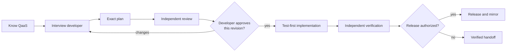

# QaaS Platform Development Plugin

A Claude Code plugin for developers changing the
[TheSmokeTeam](https://github.com/TheSmokeTeam) QaaS platform. It combines live
repository evidence, the QaaS knowledge graph, strict specification-driven
planning, test-first implementation, independent verification, and release
discipline so a developer does not need to be fluent in every QaaS repository.

This plugin develops the platform itself. It is not a guide for authoring test
scenarios with QaaS.

## The workflow



The approval boundary is exact: the reviewed revision and content digest,
developer-approved revision and digest, and current plan must match. A material
plan edit or source-baseline change stops implementation and returns to planning.

## One owner per stage

| Stage | Owner | Output |
|---|---|---|
| Understand | `qaas-platform-overview` | Know QaaS Context Brief |
| End-to-end orchestration | `develop-qaas-change` | Stage transitions and handoffs |
| Interview, specify, review, approve | `plan-qaas-change` | Frozen reviewed plan revision |
| Implement | `implement-qaas-change` | Plan-conforming test-first diff |
| Verify | `qaas-verifier` agent | Acceptance-criterion evidence verdict |
| Release | `release-and-mirror` | Verified package/mirror/docs outcome |

Supporting skills have narrower responsibilities:

- `find-qaas-knowledge` locates authoritative repository, documentation, and
  graph evidence.
- `qaas-knowledge-graph` answers cross-repository architecture and impact
  questions from the canonical graph.
- `add-framework-hook` supplies the Type A implementation overlay.
- `extend-framework-core` supplies the Type B implementation overlay.

The `qaas-change-planner` and `qaas-plan-reviewer` agents are intentionally
separate, non-editing roles. Neither can authorize implementation.

## Commands

| Command | Use |
|---|---|
| `/qaas-platform-dev:qaas-change <request>` | Run the complete change lifecycle |
| `/qaas-platform-dev:qaas-plan <request>` | Stop after the plan approval decision |
| `/qaas-platform-dev:qaas-where <question>` | Understand ownership and find evidence |
| `/qaas-platform-dev:qaas-release <target>` | Plan or execute an authorized release |

Skills remain directly invocable under the `qaas-platform-dev` namespace.

## Developer-plugin interoperability

The planning stage can use Matt Pocock's model-invoked `grilling` skill for the
developer interview and Ponytail's active minimality level for solution scope.
Other already-active developer plugins may strengthen discovery, coding,
testing, or review.

Interoperability is optional and bounded:

- this plugin never installs, configures, or changes another plugin;
- QaaS repository evidence and local instructions remain authoritative;
- no plugin can bypass technical review, content-bound developer approval,
  tests, independent verification, or release authorization.

## Install

In Claude Code:

```text
/plugin marketplace add TheSmokeTeam/qaas-dev-claude-plugins
/plugin install qaas-platform-dev@qaas-dev-claude-plugins
```

For local development:

```bash
claude --plugin-dir .
```

## Repository organization

```text
.claude-plugin/   package and marketplace metadata
commands/         thin user entry points
skills/           one workflow or domain responsibility per skill
agents/           isolated planner, reviewer, and verifier roles
hooks/            deterministic post-edit guard for TheSmokeTeam repositories
evals/            behavior cases organized around lifecycle gates
scripts/          deterministic generation and validation
AGENTS.md         generated portable guide; never edit directly
```

Normative behavior lives in skills and their references. Commands and this
README summarize or route; they do not redefine the workflow. `AGENTS.md` is a
generated portability artifact for agents outside Claude Code.

## Development and verification

```bash
./scripts/build-agents-md.sh --check
./scripts/validate-plugin.sh
claude plugin validate .
claude plugin eval . --scaffold --ablation none --trust-plugin \
  --allow-tools Bash Write Edit
```

The deterministic validation workflow runs on every push. Model-based evals are
manually dispatched because they require credentials, pinned models, and an
explicit cost budget.
