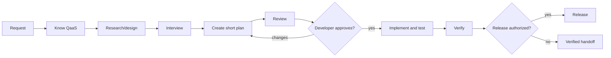

# QaaS Platform Development Plugin

A Claude Code plugin for developers changing the
[TheSmokeTeam](https://github.com/TheSmokeTeam) QaaS platform. It combines live
repository evidence, the QaaS knowledge graph, short reviewed planning,
test-first implementation, independent verification, and release
discipline so a developer does not need to be fluent in every QaaS repository.

This plugin develops the platform itself. It is not a guide for authoring test
scenarios with QaaS.

## The workflow



The reviewer establishes technical readiness; only the developer authorizes
implementation. A material plan change requires another review and explicit
approval. Before editing, the implementer rechecks the cited source facts and
returns to planning if they no longer hold.

## One owner per stage

| Stage | Owner | Output |
|---|---|---|
| Request | Developer | Requested outcome and scope |
| Know QaaS | `qaas-platform-overview` | QaaS Context Brief |
| Research/design | `plan-qaas-change` | Source-backed facts and design |
| Interview | `plan-qaas-change` | Confirmed developer decisions |
| Create short plan | `plan-qaas-change` | Evidence-backed, test-first plan |
| Review | `qaas-plan-reviewer` agent | Material findings and readiness |
| Developer approves | Developer | Explicit implementation authorization |
| Implement and test | `implement-qaas-change` | Plan-conforming tested diff |
| Verify | `qaas-verifier` agent | Acceptance-criterion evidence verdict |
| Release if authorized | `release-and-mirror` | Verified package/mirror/docs outcome |

Supporting skills have narrower responsibilities:

- `find-qaas-knowledge` locates authoritative repository, documentation, and
  graph evidence.
- `qaas-knowledge-graph` answers cross-repository architecture and impact
  questions from the canonical graph.
- `add-framework-hook` supplies the Type A implementation overlay.
- `extend-framework-core` supplies the Type B implementation overlay.

The `qaas-plan-reviewer` and `qaas-verifier` agents are intentionally separate,
non-editing roles. Neither can authorize implementation.

## Commands

| Command | Use |
|---|---|
| `/qaas-platform-dev:qaas-change <request>` | Run the complete change lifecycle |
| `/qaas-platform-dev:qaas-plan <request>` | Stop after the plan approval decision |
| `/qaas-platform-dev:qaas-where <question>` | Understand ownership and find evidence |
| `/qaas-platform-dev:qaas-release <target>` | Plan or execute an authorized release |

Skills remain directly invocable under the `qaas-platform-dev` namespace.

## External workflow providers

QaaS 0.5.0 declares two hard same-marketplace dependencies. Installing only
`qaas-platform-dev` installs and enables both providers:

- `mattpocock-skills` 1.3.2 at commit
  `4ae2317ddb22b046e26455e4f9c9b3aaaf62212d`, providing
  `mattpocock-skills:grilling` for developer interviews.
- `ponytail` 5.3.3 at commit
  `96608e078b2d5ea607c5c3b8b5a54d1c1fba6846`, providing
  `ponytail:ponytail` full minimality analysis for planning, implementation,
  independent review, and independent verification.

Every required call is explicit. Success is reported as
`Provider: exact-skill-id — SUCCEEDED`. If the plugin loaded but a required Skill
call fails, the stage reports `BLOCKED_PROVIDER: exact-skill-id — cause` and
stops; QaaS contains no interview or minimality fallback. QaaS still owns the
evidence boundary, short plan, independent review, developer approval,
test-first implementation, verifier, and release authorization. It deliberately
does not impose plan-state metadata, history tables, hashes, or a fixed template.

Claude handles dependency availability natively. A missing provider prevents
QaaS from loading and names the dependency. Claude also refuses to disable a
provider while enabled QaaS depends on it, and enabling QaaS automatically
enables its disabled providers. Those load-time errors are distinct from the
post-load `BLOCKED_PROVIDER` marker.

QaaS does not configure either provider. Ponytail 5.3.3 contributes
`SessionStart`, `SubagentStart`, and `UserPromptSubmit` hooks. Its provider-owned
`ledger` setting defaults to true and records task name, cost, turns, agent time,
tokens, reuse, and tests in `~/.config/ponytail/band/<project>.csv`. Its optional
`webhookUrl` can send that task row as JSON; an optional token is sent as a
Bearer token, and `sendNames` controls task-name transmission. Set Ponytail's own
`ledger` user setting to false to disable the local ledger. QaaS never changes
these settings.

## Install

In Claude Code:

```text
/plugin marketplace add TheSmokeTeam/qaas-dev-claude-plugins
/plugin install qaas-platform-dev@qaas-dev-claude-plugins
```

For local development:

```bash
git -C ../mattpocock-skills checkout 4ae2317ddb22b046e26455e4f9c9b3aaaf62212d
git -C ../ponytail checkout 96608e078b2d5ea607c5c3b8b5a54d1c1fba6846
claude --plugin-dir . \
  --plugin-dir ../mattpocock-skills \
  --plugin-dir ../ponytail
```

## Repository organization

```text
.claude-plugin/   package and marketplace metadata
commands/         thin user entry points
skills/           one workflow or domain responsibility per skill
agents/           isolated reviewer and verifier roles
hooks/            deterministic post-edit guard for TheSmokeTeam repositories
evals/            behavior cases organized around lifecycle gates
scripts/          deterministic generation and validation
AGENTS.md         generated portable guide; never edit directly
```

Normative behavior lives in skills and their references. Commands and this
README summarize or route; they do not redefine the workflow. `AGENTS.md` is a
generated portability artifact for agents outside Claude Code.

## Development and verification

```bash
./scripts/build-agents-md.sh --check
./scripts/validate-plugin.sh
./scripts/verify-plugin-install.sh
claude plugin validate .
python3 scripts/provider_eval_runner.py \
  --plugin-root . \
  --grilling-root ../mattpocock-skills \
  --ponytail-root ../ponytail \
  --model "$AGENT_MODEL" \
  --judge-model "$JUDGE_MODEL" \
  --runs 3 --threshold 1.0 --max-cost-usd 30
```

The deterministic validation workflow runs on every push. Model-based evals are
manually dispatched because they require credentials, pinned models, and an
explicit cost budget.

Knowledge-graph queries require uv 0.13.7. The wrapper synchronizes the committed
`qaas-graph` graph plus its `pyproject.toml` and `uv.lock`, then runs Graphify from
that locked project, so the Graphify version comes only from `qaas-graph`; the
QaaS plugin does not hardcode it. The wrapper never generates a graph, probes for
a global Graphify binary, parses `requirements.txt`, or installs tooling
automatically.
